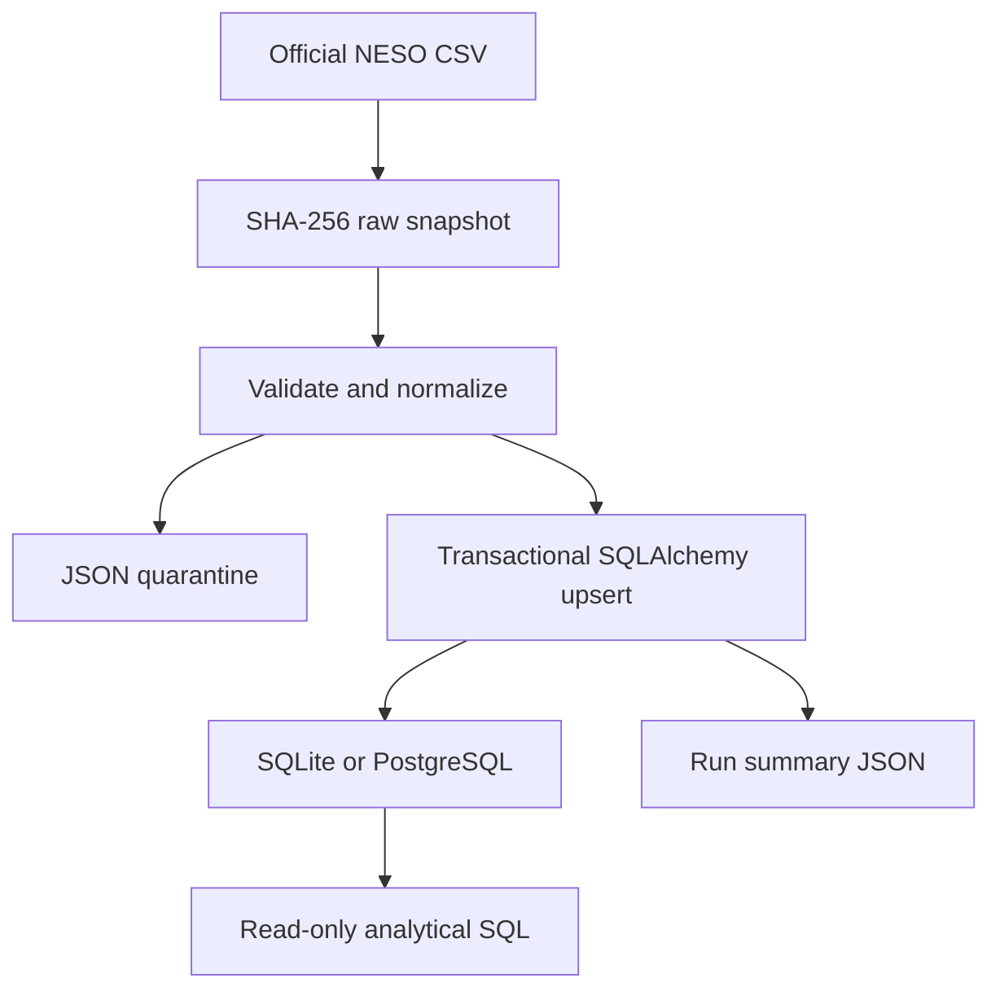

# Architecture

Standard-library CSV parsing avoids unnecessary dataframe dependencies. SQLAlchemy
owns the schema. A batch validates before one atomic upsert transaction. A row hash
covers all normalized source fields; the natural key is date plus settlement period.
Within-file duplicate keys are all quarantined to avoid arbitrary winners. Separate
batches use last successfully loaded changed record wins. Unchanged records retain
their original write provenance; every source file remains in the raw archive.

V1 assumes one writer at a time; concurrent count accounting is not supported.
The database enforces uniqueness regardless. Preloading existing keys/hashes is a
simple bounded approach suitable for this annual dataset, not a streaming design.
No timestamps are inferred from settlement periods. Date-sensitive bounds use UK
clock-change rules; missing periods/days are not filled or silently manufactured.

Later AI entry point: read-only connection to energy_records and the reviewed SQL
queries. A separate service must enforce read-only permissions and query limits.
No AI application is implemented here.
